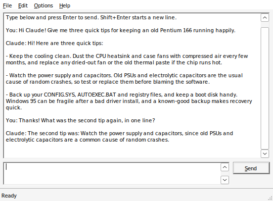

# Claude 95

**Chat with Claude from Windows 95.** A native Win32 chat program for real
90s hardware, plus a tiny gateway that runs on a Raspberry Pi (or any computer)
on the same network.



It started as a fun project for a restored 1996 Pentium 166, and it works on
a stock Windows 95 install: one EXE of about 25KB, no runtimes, no installers.

- Talks to Claude (Haiku 5.5 by default, so it costs fractions of a cent a message)
- Searches the web when a question needs current information, and lists its sources
- Remembers the conversation; save transcripts to a text file
- **Writing Assist** in any program: select text, press **Ctrl+Alt+W**, and
  Claude rewrites, proofreads, shortens, summarizes or continues it. You
  review the result before it goes back in
- A **Claude menu for Word 95** ([word/](word/README.md))
- Daily limits on messages and searches, so nothing runs away with your credits
- Coming next: tools Claude can use on the PC

## How it works

```
 Windows 95 PC                  Gateway (Raspberry Pi, Linux box...)       Anthropic
+---------------+  plain HTTP  +-------------------------------+   HTTPS   +---------+
| CLAUDE95.EXE  | -----------> | claude95d.py                  | --------> | Claude  |
| Winsock 1.1   |  local net   | holds the API key, web search,|           | API     |
+---------------+              | daily limits, text conversion |           +---------+
                               +-------------------------------+
```

Windows 95 can't make the modern TLS connections the Anthropic API requires,
so the PC talks plain HTTP to the gateway on your local network, and the
gateway does the HTTPS part. Your API key lives only on the gateway, and the
gateway only answers the addresses you allow.

## Quick start

You need an Anthropic API key from [console.anthropic.com](https://console.anthropic.com/)
and a Windows 95 PC with TCP/IP networking working
(see [docs/windows95-setup.md](docs/windows95-setup.md)).

### 1. Run the gateway

On a Raspberry Pi or any Linux machine that stays on (Python 3.10 or newer,
so Raspberry Pi OS Bookworm or later; on older systems use Docker):

```bash
git clone https://github.com/disconnex/claude95.git
cd claude95/gateway
sudo ./deploy.sh                      # installs a systemd service
sudo nano /etc/claude95/claude95.env  # API key and the Windows 95 PC's address
sudo systemctl enable --now claude95
```

Or with Docker:

```bash
cd claude95/gateway
cp claude95.env.example claude95.env  # then edit it
docker build -t claude95-gateway .
docker run -d --name claude95 --restart unless-stopped -p 8095:8095 \
  --env-file claude95.env -v claude95-state:/state claude95-gateway
```

Or just run it (any OS with Python):

```bash
pip install -r requirements.txt
export ANTHROPIC_API_KEY=sk-ant-...  C95_ALLOW=192.168.1.50
python claude95d.py
```

To check it's up, run `curl http://<gateway-ip>:8095/hello` from another
machine. It answers `403` unless that machine is in `C95_ALLOW`, but any
answer means the gateway is running.

### 2. Run Claude 95 on the PC

1. Download `CLAUDE95.EXE` from the [latest release](../../releases/latest),
   or [build it yourself](#building-the-client).
2. Get it onto the Windows 95 PC: floppy, CD, CF card, or a network share
   ([docs/file-share.md](docs/file-share.md) shows a Samba share Windows 95
   can use).
3. Run it. The first time, it asks for the gateway's address (for example
   `192.168.1.10`, port `8095`) and saves it in `CLAUDE95.INI` next to the EXE.

The status bar should say *Connected to the gateway (claude-haiku-5-5)*.

### 3. Writing Assist (optional)

Leave Claude 95 running (minimized is fine). In any program, select some text
and press **Ctrl+Alt+W**. The Assist window shows the text and a list of
actions, or you can type your own instruction ("turn this into a bulleted
list"). With nothing selected, it writes new text from your instruction.
Then choose **Replace Text**, **Insert After** or **Copy**.

To use different keys, pick **Options > Writing Assist Hotkey** and press the
combination you want. Avoid keys the PC itself uses: many 90s BIOSes take
Ctrl+Alt with Space, Esc or Ins for suspend or setup, and no program can
override those.

For a Claude menu inside Word 95, see [word/README.md](word/README.md).

## Gateway settings

All settings are environment variables, usually in `claude95.env`
(template: [gateway/claude95.env.example](gateway/claude95.env.example)).

| Setting | Default | What it does |
| --- | --- | --- |
| `ANTHROPIC_API_KEY` | (required) | Your API key |
| `C95_ALLOW` | (required) | Addresses or networks that may connect, e.g. `192.168.1.50` or `192.168.1.0/24` |
| `C95_HOST` / `C95_PORT` | `0.0.0.0` / `8095` | Where to listen |
| `C95_MODEL` | `claude-haiku-5-5` | The Claude model |
| `C95_EFFORT` | `medium` | How hard the model works: `low`, `medium` or `high` |
| `C95_DAILY_MESSAGES` | `300` | Messages per day |
| `C95_DAILY_SEARCHES` | `40` | Web searches per day |
| `C95_MACHINE` | `a vintage PC running Windows 95` | A line about your PC, so Claude knows what it's on |

## Cost

With Haiku 5.5 (US$0.10 per million input tokens, $0.50 per million output),
a typical chat message costs a few hundredths of a cent. Web searches are
about 1 cent each and are the main cost, which is why there's a daily search
limit. `Options > Today's Usage` in the app shows the day's counts.

## Security

- The PC-to-gateway link is **plain, unencrypted HTTP**, because that's what
  Windows 95 can do. Keep the gateway on your own local network; never
  forward its port to the internet.
- `C95_ALLOW` is required, and every other address gets `403`.
- The API key never leaves the gateway. Keep `claude95.env` out of git
  (it's in `.gitignore`).

## Building the client

The client is C with no C runtime, cross-compiled on Linux with MinGW:

```bash
sudo apt install gcc-mingw-w64-i686 make
make -C client               # builds client/build/CLAUDE95.EXE
make -C client install DEST=user@host:/path/to/share
```

Every build runs `client/tools/check-win95.sh`, which fails if the EXE
imports any function Windows 95 doesn't have, isn't marked for Windows 4.0,
or uses instructions a plain Pentium lacks. Releases are built the same way
by GitHub Actions.

To test without a Windows 95 PC, the client runs under Wine:
`wine client/build/CLAUDE95.EXE`. `client/tools/drive.c` can type into it
for automated tests.

## Protocol

Plain HTTP/1.0; every body is Windows-1252 text with CRLF line endings.

| Request | Reply |
| --- | --- |
| `GET /hello` | `claude95 gateway OK` and `model <name>` |
| `GET /usage` | Today's message, search and token counts |
| `POST /chat` with the message as the body, and `X-Conversation: <id>` to continue a chat | `200` with Claude's reply, `X-Conversation` and `X-Searches` headers |
| `POST /assist` with the selected text as the body (may be empty), `X-Action: rewrite`, `proofread`, `shorter`, `longer`, `formal`, `friendly`, `summarize`, `continue`, `explain` or `custom`, and optionally `X-Instruction: <text>` | `200` with the finished text, ready to paste |

Errors come back as `4xx`/`5xx` with a short message to show the user.

The gateway keeps conversations in memory and forgets them after 12 idle hours.

## Roadmap

1. ~~Chat with web search~~ (v0.1)
2. ~~Writing Assist and a Word 95 menu~~ (v0.3)

See [CHANGELOG.md](CHANGELOG.md) for what changed in each version.
3. Tools on the PC: Claude can list folders, read and write files and launch
   programs, asking first with a Yes/No box
4. Maybe: Windows 3.1 (Win32s), NT 4.0 testing, a RichEdit transcript with bold names

## Contributing

Ideas, bug reports and pull requests are welcome, especially from anyone
with real 90s hardware to test on. See [CONTRIBUTING.md](CONTRIBUTING.md).

## License

MIT; see [LICENSE](LICENSE). Claude is a product of Anthropic; this is an
unofficial fan project and isn't affiliated with or endorsed by Anthropic.
